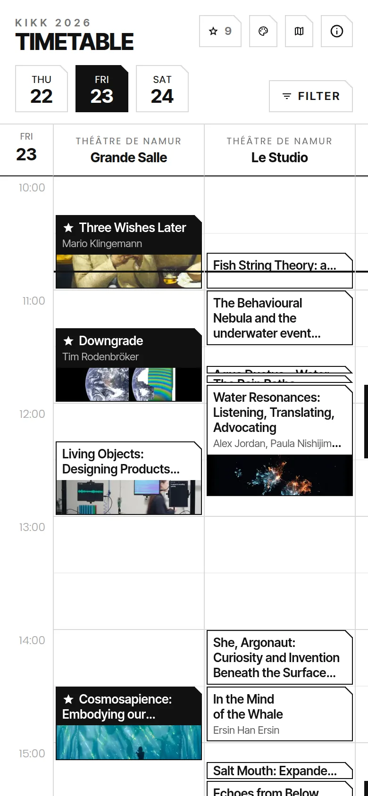
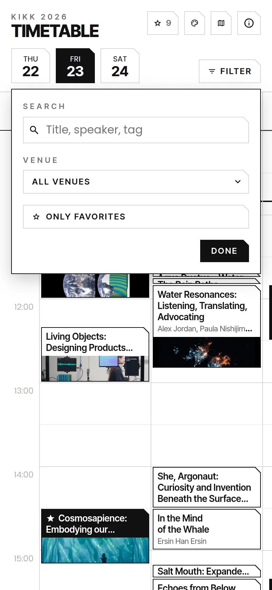
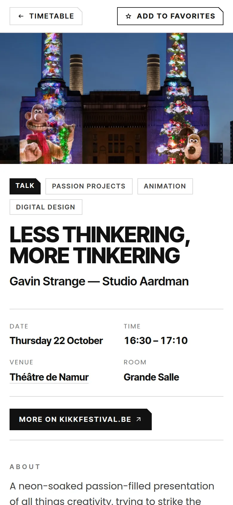
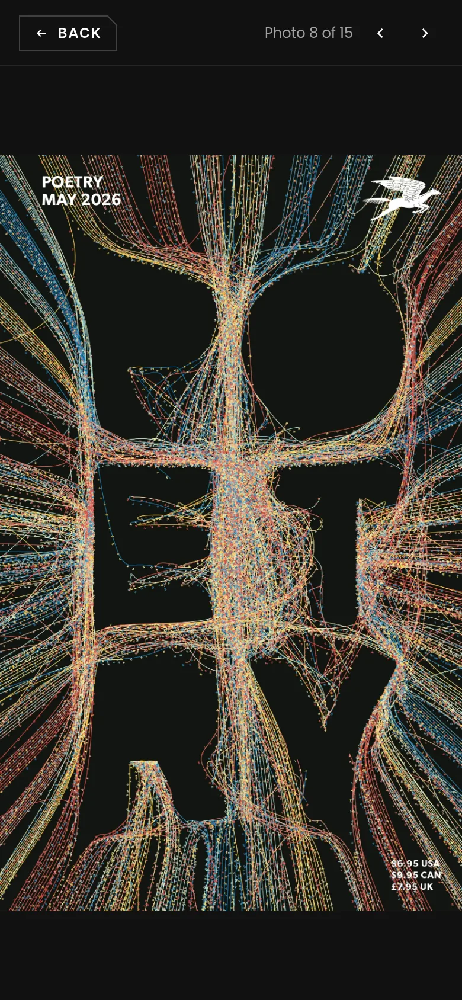
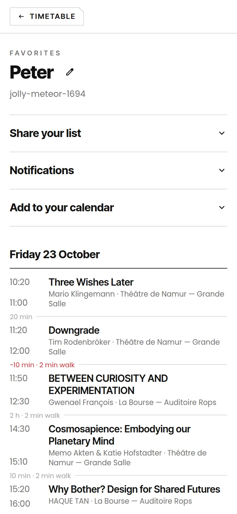
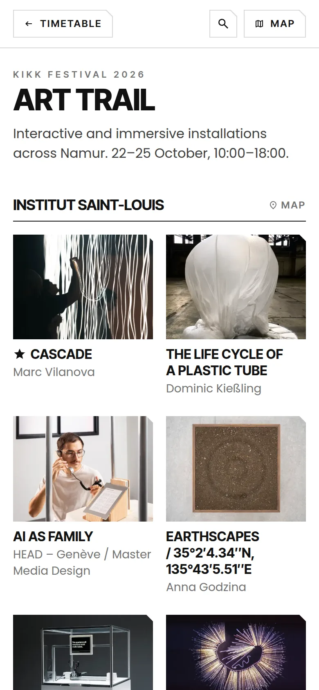
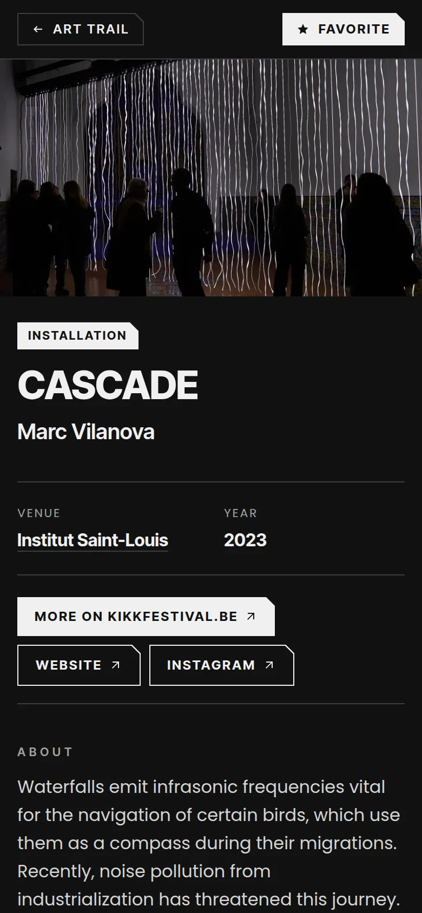
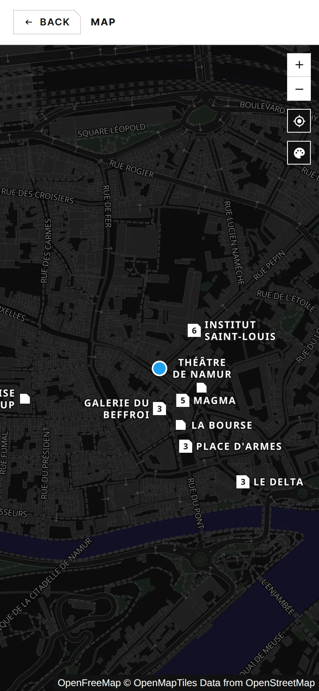
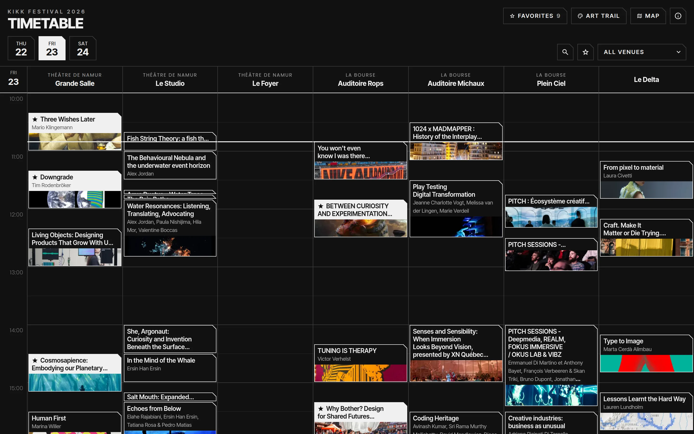

# KIKK 2026 timetable

An unofficial timetable for [KIKK Festival](https://www.kikkfestival.be) 2026, the festival of digital and creative cultures in Namur, Belgium (22–24 October). It shows all the talks, panels, parties and art trail installations, lets you keep a list of favorites without an account, and works offline on your phone.

**Open it at [kikk.avecsans.studio](https://kikk.avecsans.studio).**

<table>
  <tr>
    <td width="25%"></td>
    <td width="25%"></td>
    <td width="25%"></td>
    <td width="25%"></td>
  </tr>
  <tr>
    <td align="center">Timetable</td>
    <td align="center">Filters</td>
    <td align="center">Talk</td>
    <td align="center">Photo viewer</td>
  </tr>
  <tr>
    <td width="25%"></td>
    <td width="25%"></td>
    <td width="25%"></td>
    <td width="25%"></td>
  </tr>
  <tr>
    <td align="center">Favorites</td>
    <td align="center">Art trail</td>
    <td align="center">Installation (dark mode)</td>
    <td align="center">Map</td>
  </tr>
  <tr>
    <td colspan="4"></td>
  </tr>
  <tr>
    <td colspan="4" align="center">Timetable on desktop (dark mode)</td>
  </tr>
</table>

## Why

I wanted an easier way to explore the KIKK programme and save my favorites, so I built one.

The programme comes from [kikkfestival.be](https://www.kikkfestival.be/schedule), the official source, and updates automatically: changes usually show up within a few minutes. When KIKK can't be reached, or you're offline, you can still browse the last saved programme.

## Features

**Timetable**

- All talks, panels and parties per day, with a column per venue. Pinch to zoom in on a busy afternoon.
- Opens at the current time, with a line marking now.
- Search titles, speakers, companies and descriptions, in English and French. Filter on a venue or on your favorites.
- A page for every event, with the speakers, photos (full screen, with zoom), and a link to its venue on the map.
- Favorites that are out of sight to the left or right leave a sticky bar on the sides

**Art trail**

- All installations, grouped by place. Swipe between works.
- The place, year, materials and links for each work.

**Favorites**

- Star talks, parties and artworks. No account needed.
- Your list has its own link: open it on another device to use the same list, or send it to friends so they can see what you're going to.
- Shows the break between favorites and the walking time when they're at different venues, and warns when the break is too short.
- Notifications 10 minutes before a favorite starts.
- Subscribe to your list in your calendar app.

**Map**

- All the venues on a custom dark map
- Optionally show the number of artworks at each place
- Optionally show where you are.
- Per venue links to directions, events or artworks.

**Everywhere**

- Made for phones. Install it on your home screen and it works offline.
- Follows your phone's light or dark mode.
- Analytics without cookies (PostHog in cookieless mode), so no cookie banner and privacy friendly.

## Development

A [Nuxt 4](https://nuxt.com) app with Tailwind CSS v4, using the [Vite+](https://viteplus.dev) toolchain (`vp`). The code is mostly AI-generated, with [Claude Code](https://claude.com/claude-code). [AGENTS.md](AGENTS.md) describes how it works in detail.

```sh
cp .env.example .env # Optional: without Supabase credentials, the committed snapshots are served
vp install
vp run dev
```

- `vp check` and `vp test` format, lint, type check and test.
- `vp run snapshot` refreshes the fallback data in `server/assets/`.
- `vp run screenshots` retakes the screenshots above from the dev server, with Chrome. Pass names to retake only some, e.g. `vp run screenshots map favorites`. What they show is set in `scripts/screenshots.ts`.
- It's deployed with Docker Compose (`compose.yaml`) behind an HTTPS reverse proxy.

## License

The code is available under the [MIT License](LICENSE).

This is an unofficial project, not affiliated with KIKK. The festival content, such as the texts and data of talks, parties, panels and art trail installations (including the snapshots in `server/assets/`) and the images, belongs to KIKK and the artists and is not covered by this license.
